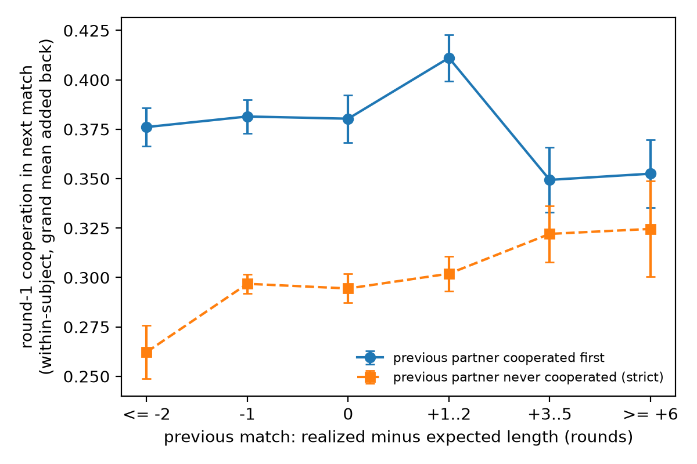

# cached-shadow

Code for *Is the shadow of the future cached as value or as prediction? Learning from relationship length in repeated cooperation* (Mingyuan Sheng, preprint in preparation). Preregistration: https://osf.io/bqge5

In indefinitely repeated prisoner's dilemma experiments, people are told how likely each match is to continue, yet a long previous match makes them more cooperative in the next one. The learning models that fit these data explain this with cached payoffs. I wanted to know whether people might be caching something else: an expectation of how long relationships last. The two ideas come apart after a long match with a partner who never cooperated. That match pays no more than a short one, so a payoff learner shouldn't care how long it was; a learner that tracks how long relationships last should.

The data are from Dal Bó & Fréchette (2011): 266 participants, 18 sessions, 13,888 first-round choices.

## What I found

- After partners who never cooperated, each extra round in the previous match went with 0.55 percentage points more first-round cooperation in the next one (95% CI 0.18 to 0.96, session bootstrap). After partners who cooperated first, the slope was 0.24 (-0.23 to 0.70).
- The slope after never-cooperating partners held up when I controlled for the number of matches left in the session (0.56), for rounds already played (0.47), and when I dropped each session's last three matches (0.54). It was small, though, and not reliable in the nine δ = 3/4 sessions on their own (0.14).
- A model that learns the expected horizon from experience beat planning with the stated continuation probability (ΔBIC = 54) and predicted held-out sessions best. When I added either a cached value or a cached horizon to the same planner, the horizon won (ΔBIC = 26.7), and with both in the model the value term went to zero. This matched comparison was not preregistered.
- None of the models reproduces the steep slope after partners who defect first and cooperate later. They all read the partner's type from its first move, which is the obvious thing to fix next.



## Running it

The data can't be redistributed here. Get the replication package from openICPSR (project 112401, https://doi.org/10.3886/E112401V1; you need a free account), then:

```bash
pip install -r requirements.txt
python -m src.prep --inspect path/to/downloaded/file   # see what the columns are called
cp data/df2011_config.example.json data/df2011_config.json
# edit the config so the column names match, then:
python -m pytest -q
```

Each table and figure comes from one command (add `--config data/df2011_config.json` to the ones that use data):

| Output | Command |
| --- | --- |
| Table 3, Figure 2 | `python -m src.signature`, `python -m src.robustness --subsets` |
| Table S1 | `python -m src.robustness --session-end` |
| Table 4 (fits and cross-validation) | `python -m src.robustness --cv-warm` |
| Figure 1 | `python -m src.predict --theory` |
| Figure 3 | `python -m src.fitting --recover planner` (and `value_cache`, `prediction_cache`), `python -m src.fitting --model-recovery` |
| Figure 4 | `python -m src.predict --ppc --ext` |
| Figure S1 | `python -m src.extensions --recover`, `python -m src.extensions --model-recovery` |

The cross-validation run takes about half an hour.

`python -m src.prep` with no arguments downloads a small public subset of the same experiment (the late matches only, from the R package stratEst). It's handy for checking that the code runs: use `--stratest data/stratEst_DF2011_late_subset.rda` instead of `--config`. Don't use it for results, since the models assume they start at a participant's first match.

## Files

- `src/prep.py`: reads the data, maps column names, builds one row per participant and match
- `src/models.py`: the planner, value cache and prediction cache
- `src/extensions.py`: the matched comparison (planner plus one cached quantity)
- `src/fitting.py`: maximum likelihood, cross-validation, parameter and model recovery
- `src/signature.py`: the model-free regression
- `src/predict.py`: predicted and posterior-predictive slopes
- `src/robustness.py`: session-end and time-on-task checks, refits with nested starting values
- `tests/`: properties each model has to satisfy

## Notes

I used Claude (Anthropic) while building this. It scaffolded much of the analysis code and wrote `src/extensions.py` and `src/robustness.py`. I wrote the three models in `src/models.py`, ran all the analyses and checked the results. The paper's transparency section says the same.

The code is MIT licensed. The data belong to Dal Bó & Fréchette and are cited below.

## References

Dal Bó, P., & Fréchette, G. R. (2011). The evolution of cooperation in infinitely repeated games: Experimental evidence. *American Economic Review, 101*(1), 411–429.

Fudenberg, D., & Karreskog Rehbinder, G. (2024). Predicting cooperation with learning models. *American Economic Journal: Microeconomics, 16*(1), 1–32.

Mengel, F., Orlandi, L., & Weidenholzer, S. (2022). Match length realization and cooperation in indefinitely repeated games. *Journal of Economic Theory, 200*, 105416.
